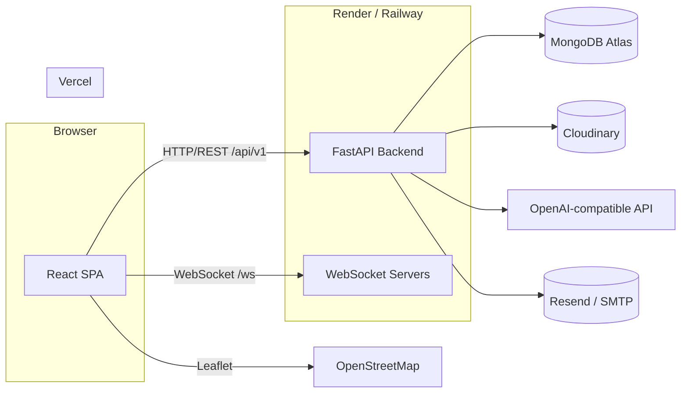

# Legal Connect — Architecture

## System Overview



## Layers (Backend)

```
routers  →  schemas  →  services  →  repositories  →  models (MongoDB)
   │                                  │
   └── HTTP / WS + auth + RBAC        └── data access + indexes
```

- **Routers**: HTTP endpoints under `/api/v1`, WebSocket endpoints under `/ws`.
- **Schemas**: Pydantic request/response models (validation).
- **Services**: business logic (auth, appointments, cloudinary, ai, pdf, email).
- **Repositories**: MongoDB data-access operations (queries, indexes).
- **Models**: document shapes / collections.

## Frontend Structure

- **State**: Zustand (auth, theme); TanStack Query for server state.
- **HTTP**: Axios instance with JWT attach + refresh interception.
- **Routing**: React Router; protected + role-based route guards.
- **Forms**: React Hook Form + Zod.
- **Styling**: Tailwind CSS (light/dark mode), Framer Motion for animations, Recharts for analytics.

## Security Boundaries

- Frontend never talks directly to MongoDB, Cloudinary, or external AI providers.
- All such calls pass through the authenticated backend.
- Cloudinary files stored privately; downloads use time-limited signed URLs.
- Never expose Cloudinary/AI secrets to the React application.
