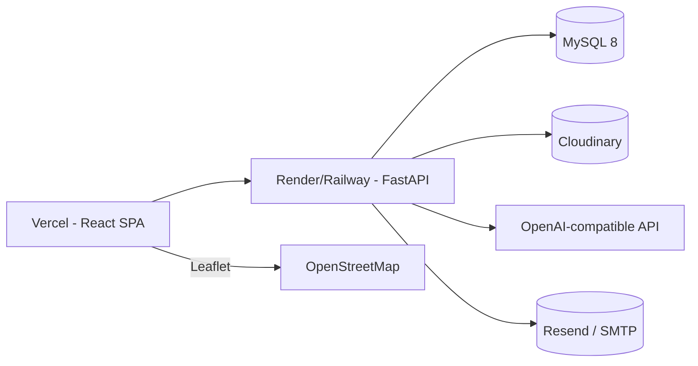

# Legal Connect — Deployment

The platform is designed to deploy **without Docker**. All services are cloud-hosted.

## Architecture (production)

## Environment Variables

Required at runtime (see `.env.example`):

- `MYSQL_HOST`, `MYSQL_PORT`, `MYSQL_USER`, `MYSQL_PASSWORD`, `MYSQL_DATABASE`
- `JWT_SECRET_KEY`, `SECRET_KEY`
- `CLOUDINARY_CLOUD_NAME`, `CLOUDINARY_API_KEY`, `CLOUDINARY_API_SECRET`
- `FRONTEND_URL`, `BACKEND_URL`, `CORS_ORIGINS`
- Optional: `OPENAI_API_KEY`, `OPENAI_MODEL`, SMTP/Resend, `GOOGLE_MAPS_API_KEY`, TURN creds

Frontend must use only `VITE_`-prefixed variables: `VITE_API_URL`, `VITE_SOCKET_URL`.

## Backend (Render / Railway)

- Start command: `uvicorn app.main:app --host 0.0.0.0 --port ${PORT:-8000}`
- Set all environment variables in the dashboard.
- Health check uses `GET /api/v1/health`.
- `render.yaml` is included for Render blueprint deploys.

## Frontend (Vercel)

- Build: `npm run build` (produces `dist/`)
- Set `VITE_API_URL=https://<backend-url>/api/v1` and `VITE_SOCKET_URL=wss://<backend-url>`.
- Configure the backend `CORS_ORIGINS` to include the Vercel domain.

## No Docker / No Firebase

- There is intentionally **no Dockerfile / docker-compose**.
- There is **no Firebase** dependency anywhere in the project.

## Public URL

Example target: `https://legal-connect.example.com` (frontend) with the backend behind a
Render/Railway subdomain.
