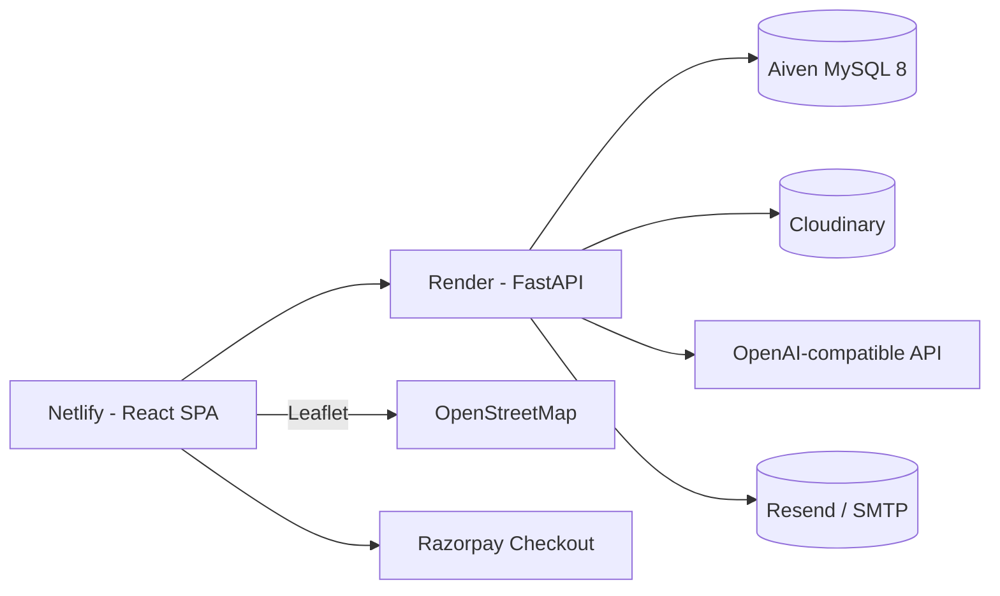

# Legal Connect — Deployment Runbook

Production topology:

```
Netlify (React/Vite SPA)  ──HTTPS/WS──►  Render (FastAPI + uvicorn)
        │                                      │
        │                                      ├── Aiven MySQL 8 (asyncmy, TLS)
        │                                      ├── Cloudinary (documents/images)
        │                                      ├── OpenAI-compatible API (AI)
        │                                      ├── SMTP / Resend (email)
        │                                      └── Razorpay (payments)
        └──► Razorpay Checkout (browser, opened by the SPA)
```



The repo already contains `render.yaml` (backend Blueprint) and `netlify.toml`
(frontend build + SPA fallback, with `frontend/public/_redirects` as a backstop).
This runbook is the order of operations. Everything marked **(secret)** must be
filled in from the provider dashboard — `render.yaml` declares them with
`sync: false` on purpose so no secret is committed.

> Run every local command from the repository root unless stated otherwise.

---

## 0. Prerequisites

- A GitHub repo containing this project (Render and Netlify deploy from Git).
- Accounts: [Aiven](https://aiven.io), [Render](https://render.com),
  [Netlify](https://netlify.com), [Razorpay](https://dashboard.razorpay.com),
  and (for documents) [Cloudinary](https://cloudinary.com).
- Generate two strong secrets (≥32 random chars) for `SECRET_KEY` and
  `JWT_SECRET_KEY`, e.g. `python -c "import secrets;print(secrets.token_urlsafe(48))"`.
  The app **refuses to start in production** with the default/weak values, a
  localhost MySQL host, or localhost-only CORS (`validate_production_settings`).

---

## Phase A — Back up the existing data (non-destructive)

Before migrating anything, capture a verified logical backup of the current MySQL
database and keep the original untouched until production is confirmed:

```powershell
# from the repo root; adjust credentials as needed
$env:MYSQL_PWD="<local-root-password>"
mysqldump --single-transaction --routines --triggers --set-gtid-purged=OFF `
  --default-character-set=utf8mb4 -h localhost -u root legal_connect `
  > legal_connect_backup_<date>.sql
```

Verify it by restoring into a scratch database (`legal_connect_restore_check`) and
comparing row counts. `alembic current` should read `c9e8f1a2b3d4` (head) before
you migrate.

---

## Phase B — MySQL on Aiven

Aiven runs standard MySQL 8 with full foreign-key support, so the schema works
unchanged (PlanetScale does **not** support foreign keys and is unsuitable here).

1. Aiven Console → **Create service → MySQL** → **Free** plan → region **Asia,
   Bangalore (blr)** (or the closest region). The free tier needs no credit card.
2. Create the database **`legal_connect`** and copy the connection details:
   **host**, **port** (non-standard), **user** (`avnadmin`), **password**, and the
   **CA certificate** (download `ca.pem`).
3. Import the backup over TLS, then confirm the row counts match Phase A:

   ```powershell
   mysql --ssl-mode=REQUIRED -h <aiven-host> -P <aiven-port> -u avnadmin -p `
     legal_connect < legal_connect_backup_<date>.sql
   ```

   Do **not** run `scripts/seed_database.py` — the data is already migrated.
4. Do **not** create tables by hand. The backend start command runs
   `alembic upgrade head`, and `AUTO_CREATE_TABLES=false` in production.

Map the Aiven values to the backend variables in Phase C:

   | Aiven value | Backend env var |
   |---|---|
   | host | `MYSQL_HOST` |
   | port | `MYSQL_PORT` |
   | `avnadmin` | `MYSQL_USER` |
   | password | `MYSQL_PASSWORD` **(secret)** |
   | (created) | `MYSQL_DATABASE` (`legal_connect`) |
   | `ca.pem` contents | `MYSQL_SSL_CA` **(secret)** |

Keep these handy for Phase C and for creating the admin account (Phase F).

---

## Phase C — Backend on Render

1. Render → **New → Blueprint**, pick the repo. Render reads `render.yaml` and
   creates the `legal-connect-backend` web service (`rootDir: backend`,
   `healthCheckPath: /api/v1/health`, free plan). `backend/.python-version` pins
   Python **3.12** for the build — Render's current default is 3.14, which breaks
   the pinned `asyncmy`/`SQLAlchemy` versions, so keep that file in the repo.
2. Fill in every **(secret)** variable on the service (Render prompts for each
   `sync: false` key). Values applied automatically: `APP_ENV=production`,
   `MYSQL_DATABASE=legal_connect`, `AUTO_CREATE_TABLES=false`,
   `MYSQL_SSL_REQUIRED=true`, `MYSQL_SKIP_DATABASE_CREATION=true`,
   `AI_PROVIDER=openai`, `SMTP_PORT=587`, `SMTP_USE_TLS=true`,
   `GEOCODING_PROVIDER=nominatim`, `WEBRTC_STUN_SERVER`, `CLOUDINARY_FOLDER`.

   | Variable | Value / source |
   |---|---|
   | `SECRET_KEY` **(secret)** | strong random string |
   | `JWT_SECRET_KEY` **(secret)** | strong random string (different from above) |
   | `MYSQL_HOST` **(secret)** | Aiven host |
   | `MYSQL_PORT` **(secret)** | Aiven port (non-standard — copy from the service Overview, **not** 3306) |
   | `MYSQL_USER` / `MYSQL_PASSWORD` **(secret)** | `avnadmin` / Aiven password |
   | `MYSQL_SSL_CA` **(secret)** | Aiven `ca.pem` contents; `\n` escapes are accepted as a single line |
   | `FRONTEND_URL` **(secret)** | the Netlify URL (add now as a placeholder, fix after Phase D, e.g. `https://legal-connect.netlify.app`) |
   | `BACKEND_URL` **(secret)** | this service's URL, e.g. `https://legal-connect-backend.onrender.com` |
   | `CORS_ORIGINS` **(secret)** | the Netlify origin(s), comma-separated — must **not** be localhost |
   | `CLOUDINARY_CLOUD_NAME` / `CLOUDINARY_API_KEY` / `CLOUDINARY_API_SECRET` **(secret)** | Cloudinary dashboard |
   | `OPENAI_API_KEY` / `OPENAI_MODEL` / `OPENAI_BASE_URL` **(secret)** | AI provider (optional — AI degrades gracefully) |
   | `SMTP_HOST` / `SMTP_USERNAME` / `SMTP_PASSWORD` / `SMTP_FROM_EMAIL` **(secret)** | email provider, or set `RESEND_API_KEY` instead |
   | `ZEGO_APP_ID` / `ZEGO_APP_SECRET` **(secret)** | ZEGOCLOUD console (video) |
   | `RAZORPAY_KEY_ID` / `RAZORPAY_KEY_SECRET` **(secret)** | Razorpay dashboard (Phase E) |
   | `RAZORPAY_WEBHOOK_SECRET` **(secret)** | the secret you choose in Phase E |
   | `GOOGLE_MAPS_API_KEY`, `WEBRTC_TURN_*` **(secret)** | optional |

   > Email matters: unverified accounts cannot log in. Configure SMTP **or**
   > `RESEND_API_KEY` before inviting users.
3. Deploy. Confirm:
   - Build runs `pip install -r requirements.txt`.
   - Start runs `alembic upgrade head && uvicorn app.main:app --host 0.0.0.0 --port $PORT`.
   - `https://<backend>/api/v1/health` returns `{"status":"ok",...}`.
   - `https://<backend>/docs` loads.
4. If the service crashes on boot, read the log — the most likely cause is a
   guard from `validate_production_settings` (weak secret, localhost MySQL, or
   localhost-only CORS).

---

## Phase D — Frontend on Netlify

1. Netlify → **Add new site → Import an existing project**, pick the repo. The
   repo's `netlify.toml` sets **base = `frontend`**, **build = `npm run build`**,
   **publish = `dist`**, and a `/*  /index.html  200` SPA fallback so client-side
   routes survive a refresh (a drag-and-drop deploy of `frontend/dist` works too).
2. Add environment variables (Vite exposes only `VITE_`-prefixed vars at build
   time — set them before/at first build):

   | Variable | Value |
   |---|---|
   | `VITE_API_URL` **(required)** | `https://<backend-host>/api/v1` |
   | `VITE_SOCKET_URL` (optional) | `wss://<backend-host>` |

   With `VITE_API_URL` set, `SOCKET_URL` is derived automatically as the same
   host over `wss://`; the app connects to `<SOCKET_URL>/api/v1/ws`. Do **not**
   set `VITE_API_URL` to `/api/v1` — a relative API base cannot reach Render.

3. Deploy, then open the Netlify URL. If the SPA cannot reach the API, it is
   almost always CORS: go back to Phase C and set `CORS_ORIGINS` to the exact
   Netlify origin (scheme + host, no trailing slash) and redeploy the backend.

---

## Phase E — Razorpay (payments) and ZEGO (video)

1. Razorpay dashboard → **Account & Settings → API Keys** → generate keys for
   the mode you want (Test keys first). Put them in the Render service:
   `RAZORPAY_KEY_ID`, `RAZORPAY_KEY_SECRET`.
2. **Account & Settings → Webhooks → Add New Webhook**:
   - URL: `https://<backend-host>/api/v1/payments/webhook`
   - Secret: any strong string → paste into `RAZORPAY_WEBHOOK_SECRET` on Render.
   - Active events: `payment.captured`, `payment.failed`, `order.paid`.
3. ZEGOCLOUD console → Project Information → copy AppID and ServerSecret into
   `ZEGO_APP_ID` / `ZEGO_APP_SECRET` (the ServerSecret is server-side only and
   is never sent to the browser).
4. Redeploy the backend so the new values take effect.

---

## Phase F — Create the administrator account

Admins are never created through the public registration endpoint. Run the
script locally against the **production** MySQL, with the Aiven credentials in
the environment:

```powershell
# PowerShell, from the repo root
$env:MYSQL_HOST="<aiven-host>"
$env:MYSQL_PORT="<aiven-port>"
$env:MYSQL_USER="<aiven-user>"
$env:MYSQL_PASSWORD="<aiven-password>"
$env:MYSQL_DATABASE="legal_connect"
$env:MYSQL_SSL_REQUIRED="true"   # Aiven enforces TLS
$env:MYSQL_SSL_CA=(Get-Content .\ca.pem -Raw)

python scripts/create_admin.py --name "Administrator" --email admin@yourdomain.com --password "ChangeMe123!"
```

Alternatively run the same command in the Render **Shell** tab (the service
already has the env vars). The script runs `alembic upgrade head` itself, so it
is safe even on a fresh database.

Log in at `/admin/login` with that email/password, then change the password.

---

## Phase G — Demo data and credentials

The migrated database still contains the seeded demo lawyers and their shared
`DemoPass123` password. Two safe, non-destructive steps:

1. **Mark the demo lawyers.** Migration `c9e8f1a2b3d4` backfills `is_demo` for the
   known seed emails, so they render with a **Demo** badge next to **Verified**
   while staying bookable. No action needed if the migration ran.
2. **Rotate the demo passwords** so the well-known one is not live in public:

   ```powershell
   python scripts/rotate_demo_credentials.py --include-citizens
   ```

   Copy the printed credentials somewhere safe — they are not saved to disk.
   Never delete or overwrite the migrated records.

---

## Post-deploy verification checklist

- [ ] `GET https://<backend>/api/v1/health` → `status: ok` (not `degraded`).
- [ ] `/docs` loads; `/` returns the app banner.
- [ ] Register a citizen → verification email arrives → verify → log in.
- [ ] Register a lawyer → upload a verification document → admin approves it.
- [ ] Citizen books an appointment; lawyer confirms it.
- [ ] Citizen pays via Razorpay Checkout; payment shows **Paid**; the lawyer
      receives a notification and the receipt PDF downloads.
- [ ] Razorpay dashboard shows the **webhook** as delivered (HTTP 200).
- [ ] Chat sends a message in real time (WebSocket reaches `wss://<backend>/api/v1/ws`).
- [ ] Video call joins a ZEGO room.
- [ ] Admin dashboard shows INR revenue.

---

## Schema migrations

Production schema is owned by Alembic:

```bash
# apply all migrations (Render runs this automatically on every deploy)
alembic upgrade head
```

Additive migrations only; never edit tables by hand. Current chain head after
this work: `c9e8f1a2b3d4`.

---

## Troubleshooting

| Symptom | Likely cause / fix |
|---|---|
| Backend won't boot / Render says "exited" | `validate_production_settings` guard: weak `SECRET_KEY`/`JWT_SECRET_KEY`, `MYSQL_HOST` is localhost, or `CORS_ORIGINS` is localhost-only. Fix the env var and redeploy. |
| Frontend network errors in console | `CORS_ORIGINS` on the backend must contain the exact Netlify origin; or `VITE_API_URL` is wrong/relative. |
| `MYSQL ... can't connect` on Render | Aiven requires TLS: set `MYSQL_SSL_REQUIRED=true` and `MYSQL_SSL_CA` (the `ca.pem` contents); check the non-standard port and that the service allows your IPs. |
| Aiven `CREATE DATABASE` permission error on boot | Set `MYSQL_SKIP_DATABASE_CREATION=true` (Aiven pre-creates the database). |
| WebSocket fails to connect | `VITE_SOCKET_URL`/`VITE_API_URL` host wrong, or backend offline; check the browser's WS URL is `wss://<backend>/api/v1/ws?token=...`. |
| Registration emails never arrive | SMTP/Resend not configured; unverified accounts cannot log in. |
| Payment **Pay** button shows a config error | `RAZORPAY_KEY_ID`/`RAZORPAY_KEY_SECRET` missing → endpoint returns 503 on purpose. |
| Webhook 400 | `RAZORPAY_WEBHOOK_SECRET` on Render does not match the Razorpay webhook secret. |
| 401 immediately after login | Tokens are per-session; ensure the backend clock/`JWT_*` settings are consistent and `JWT_SECRET_KEY` did not change mid-session. |
| "Page not found" on refresh in Netlify | SPA fallback missing — confirm `netlify.toml` (or `frontend/public/_redirects`) is deployed and Publish directory is `dist`. |

---

## Local development (for reference)

```powershell
# Backend
cd backend
python -m venv venv; .\venv\Scripts\activate
pip install -r requirements.txt
python -m alembic upgrade head
python -m uvicorn app.main:app --reload

# Frontend (new terminal)
cd frontend
npm install
npm run dev
```

Copy `.env.example` to `.env` (repo root) and fill in local values. Run tests
with `cd backend; python -m pytest` and `cd frontend; npm test`.
