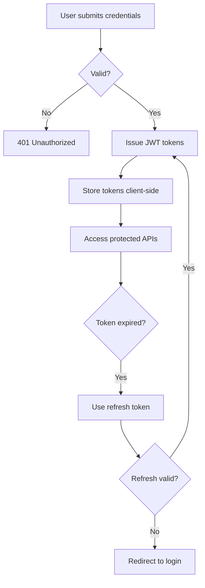

# Legal Connect — Flowcharts

## Authentication Flow



## Appointment Booking Flow

```mermaid
flowchart TD
    A[User selects lawyer + time] --> B{Lawyer verified & available?}
    B -- No --> C[Reject booking]
    B -- Yes --> D{Slot already booked?}
    D -- Yes --> C
    D -- No --> E[Create PENDING appointment]
    E --> F[Payment (demo)]
    F --> G[Lawyer accepts/rejects]
    G -- Rejected --> H[Notify user]
    G -- Accepted --> I[CONFIRMED]
    I --> J[Eligible for chat/video]
```

*(Additional flows added per phase.)*
