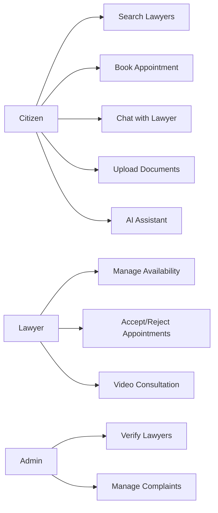

# Legal Connect — UML Diagrams

Diagrams below use Mermaid syntax and will be expanded as the corresponding phases are built.

## Use Case Overview

*(Detailed sequence, class, and activity diagrams added per phase.)*
